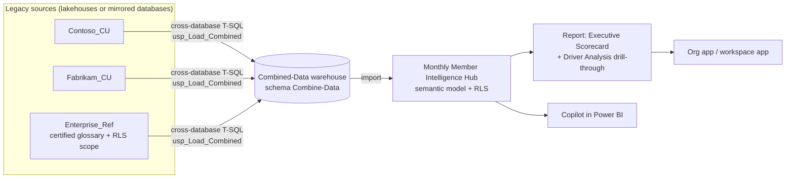

# Contoso CU + Fabrikam CU: Microsoft Fabric merger demo

An end-to-end Microsoft Fabric and Power BI demo for financial services. Two credit unions have merged. Each one has its own data and its own definition of the same KPIs. The demo follows one business story from the legacy sources to a certified executive scorecard that anyone can question in plain language, with row-level security, a human in the loop and governance throughout.

> All data is synthetic. Contoso and Fabrikam are fictitious names. This is a community sample, not an official Microsoft product. Use it at your own risk.

## What the demo shows

| Act | Story beat | Fabric and Power BI capabilities |
|---|---|---|
| 1 | The problem: two credit unions, two definitions of "delinquency" | Narrated |
| 2 | The foundation: both sources combined and certified | Lakehouse or mirroring, Data Warehouse, semantic model, Git, deployment pipelines, lineage |
| 3 | Ask, don't build: a regional director asks a question | Copilot in Power BI, row-level security, grounded answers |
| 4 | Spot it, explain it, review it | Exception scorecard, drill-through driver analysis, AI summary with human review |
| 5 | It rolls up, trusted | Executive scorecard on certified KPIs, consistent results across both legacy organizations |
| 6 | Prove it's safe (optional) | Fabric admin controls, audit, Purview, Sentinel |
| 7 | Run it at scale | Performance analyzer, Monitoring hub, Capacity Metrics, **Real-Time Estate Monitor** (live inventory, activity and capacity dashboard), governance notebook |

## Architecture

**Real-Time Estate Monitor (Act 7).** Native Fabric events (jobs, item changes, capacity) and a small admin-API collector (activity log, refreshes, full inventory, access changes) stream through one Eventstream into an Eventhouse, with a four-page Real-Time Dashboard and optional Activator alerts. A simulator adds labelled demo traffic. See [doc 07](docs/07-Real-Time-Estate-Monitor.md).

## Repository layout

| Path | What it is |
|---|---|
| `data/contoso_cu`, `data/fabrikam_cu` | Ten CSV tables per legacy credit union (branches, months, KPIs, drivers, glossary, admin and ops tables) |
| `data/enterprise_ref` | The certified KPI glossary and the RLS scope (`{tenant}` is replaced at load time) |
| `notebooks/Deploy_CU_Merger_Demo.ipynb` | One-click installer: workspaces, data, warehouse, model, report, access, RLS, pipeline and Estate Monitor |
| `notebooks/Load_Source_Data.ipynb` | Creates the three lakehouses and loads every table with explicit schemas |
| `notebooks/Fabric_Governance.ipynb` | Tenant inventory, stale content, orphaned workspaces, archive and ownership actions (Act 7) |
| `notebooks/Estate_Monitor_*.ipynb` | Real-Time Estate Monitor: one-time setup, scheduled collector, demo traffic simulator (Act 7) |
| `kql`, `dashboards` | Eventhouse table, mapping and views, and the Real-Time Dashboard definition for the Estate Monitor |
| `sql/warehouse` | Schema, the `usp_Load_Combined` procedure and validation queries for the Combined-Data warehouse |
| `sql/source` | Optional SQL scripts that build the two legacy sources as SQL databases, for the mirroring variant |
| `pbip` | The Power BI project: TMDL semantic model (parameterized) and PBIR report |
| `themes` | The report theme |
| `docs` | Setup guide, demo script, cheat sheet, mirroring variant, operations, troubleshooting and the Real-Time Estate Monitor |

## Quick start

**One click:** import `notebooks/Deploy_CU_Merger_Demo.ipynb` into an admin workspace on your Fabric capacity, set `TENANT_DOMAIN` and `REPO_RAW_ROOT`, and select **Run all**. It builds everything below, including the Estate Monitor, and lists the few steps left by hand. Details are in [the setup guide](docs/01-Setup-Guide.md#fastest-path-the-one-click-installer).

**By hand:**

About 45 minutes the first time. Full steps are in [docs/01-Setup-Guide.md](docs/01-Setup-Guide.md).

1. Create a Fabric workspace on a paid capacity (F2 or larger for Copilot).
2. Import `notebooks/Load_Source_Data.ipynb`, set `TENANT_DOMAIN` and `REPO_RAW_BASE`, and run it.
3. Create a warehouse named `Combined-Data`. Run the three scripts in `sql/warehouse`, then `EXEC [Combine-Data].[usp_Load_Combined];`.
4. Open `pbip/Monthly Member Intelligence Hub.pbip` in Power BI Desktop, set the `SqlEndpoint` parameter, refresh and publish.
5. Add the demo personas to the **Security Scope** role, give the directors Viewer access, and rehearse with [docs/02-Demo-Script.md](docs/02-Demo-Script.md).
6. Optional, about 30 minutes: in a separate admin workspace (for example **0-MONITOR**), set up the Real-Time Estate Monitor with [section 9 of the setup guide](docs/01-Setup-Guide.md#9-real-time-estate-monitor-optional-for-acts-6-and-7) and [doc 07](docs/07-Real-Time-Estate-Monitor.md). Attach its lakehouse to `Fabric_Governance` so stale scoring uses real activity history.

## Documentation

1. [Setup guide](docs/01-Setup-Guide.md)
2. [Demo script and talk track](docs/02-Demo-Script.md)
3. [One-page cheat sheet](docs/03-Demo-Cheat-Sheet.md)
4. [Optional: mirrored SQL sources and Snowflake](docs/04-Optional-Mirroring-and-Snowflake.md)
5. [Governance and operations (Act 7)](docs/05-Governance-and-Operations.md)
6. [Troubleshooting](docs/06-Troubleshooting.md)
7. [Real-Time Estate Monitor](docs/07-Real-Time-Estate-Monitor.md)

## What's new

See [CHANGELOG.md](CHANGELOG.md).

## License

MIT. See [LICENSE](LICENSE).
