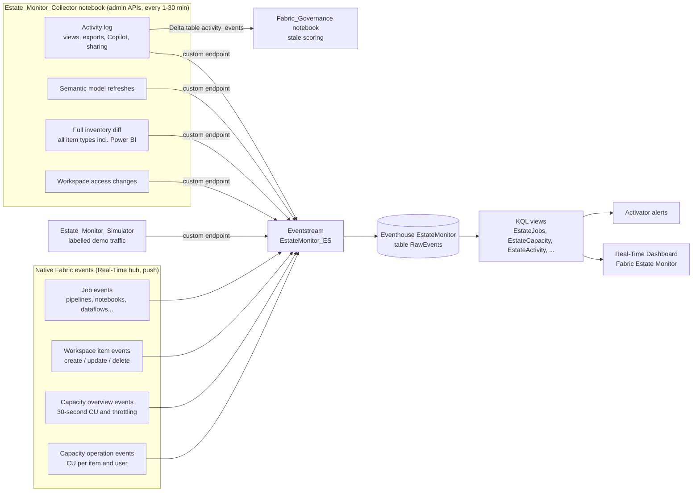

# Real-Time Estate Monitor

A live inventory and activity monitor for the whole Fabric tenant, built on Real-Time Intelligence. It answers, as it happens: *what is running, what failed, how hard is the capacity working and who is driving it, who is viewing, exporting or asking Copilot, what was created, changed or deleted, and who just got admin rights.*

It extends Act 7 (and gives Act 6 a live activity view). It replaces the account-specific inventory notebook used in the original demo, which streamed reports, semantic models and latest refreshes from one tenant.

## How it works



**Why both push and pull.** Native Fabric events arrive in seconds but don't cover everything: workspace item events skip Power BI items (reports, semantic models, apps, dashboards), and there are no native events for the activity log or workspace role changes. The collector fills those gaps from the admin APIs and sends only what changed. Every event, native or collected, uses the same CloudEvents envelope and lands in one table, so one set of views covers both.

| Dashboard page | What it shows | Fed by |
|---|---|---|
| Live operations | Capacity utilization and throttling every 30 seconds, overloaded state, running and failed jobs, live job and refresh feed, top CU consumers by item | Capacity overview and operation events, job events, collector refreshes |
| Activity and security | Users, views, Copilot use, exports (flagged at 10 or more per user), access changes (new admins flagged), activity feed | Collector activity log and access scan |
| Inventory and change | Item and workspace counts, items by type, change feed, inventory by workspace, workspaces without a user admin | Collector inventory and access scans, workspace item events |
| Collector health | Events per source, ingestion lag, collector heartbeats and errors | Everything |

## What's in the repo

| Path | Purpose |
|---|---|
| `notebooks/Estate_Monitor_Setup.ipynb` | One-time: creates the eventhouse, runs the KQL scripts, deploys the dashboard |
| `notebooks/Estate_Monitor_Collector.ipynb` | Scheduled collector (admin APIs to Eventstream, plus the `activity_events` Delta table) |
| `notebooks/Estate_Monitor_Simulator.ipynb` | Optional synthetic traffic with Act 7 story beats |
| `kql/01_Estate_Monitor_Tables.kql` | `RawEvents` table, JSON mapping `RawEvents_mapping`, retention and low-latency policies |
| `kql/02_Estate_Monitor_Functions.kql` | Typed views: `EstateCapacity`, `EstateCapacityState`, `EstateCapacityOperations`, `EstateJobs`, `EstateJobsLatest`, `EstateItemChanges`, `EstateInventory`, `EstateWorkspaces`, `EstateActivity`, `EstateAccessChanges`, `EstateAccessCurrent`, `EstateCollectorHealth`, `EstateTimeline` |
| `kql/03_Estate_Monitor_Dashboard_Queries.kql` | Every dashboard tile query, readable, for rebuilding a tile by hand |
| `dashboards/Fabric_Estate_Monitor.RealTimeDashboard.json` | The Real-Time Dashboard definition (4 pages, 35 tiles, 30-second auto refresh) |

## Prerequisites

| Need | Why |
|---|---|
| Fabric capacity (the same one as the demo is fine) | Eventhouse, Eventstream, dashboard |
| **Fabric administrator** to run the collector (or a service principal allowed to use read-only admin APIs) | Admin APIs: activity log, all workspaces and items, access, refreshables |
| **Capacity admin** on the capacity | Capacity overview and capacity operation events |
| Read on the items or workspaces you subscribe to | Job events and workspace-scoped item events. Tenant-wide item events need the Global Administrator role, so the demo uses workspace scope |
| The eventstream in the **same region** as the capacity | Job, capacity operation and OneLake events don't cross regions |
| Optional: Azure Key Vault | Holds the Eventstream connection string (and a service principal secret) so nothing sensitive sits in a notebook |

## Set it up (about 30 minutes)

### 1. Workspace

Use an admin workspace, for example **0-MONITOR**, on a paid capacity. Keep it separate from 1-DEV / 2-TEST-QA / 3-PROD so pipelines never deploy it. Create a lakehouse in it (for example **Monitor_LH**) for the collector's state and the `activity_events` table.

### 2. Eventhouse, tables and dashboard

1. Import `notebooks/Estate_Monitor_Setup.ipynb`, set `REPO_RAW_ROOT` (or `SOURCE = "files"` and upload `kql/` and `dashboards/` to the lakehouse), and **Run all**.
2. It creates the eventhouse **EstateMonitor**, the `RawEvents` table with mapping `RawEvents_mapping`, the views, and the dashboard **Fabric Estate Monitor**. It prints the query URI at the end.

**Manual alternative.** Create an eventhouse named EstateMonitor, open its KQL database, and run `kql/01_...` then `kql/02_...` (each command block separately). Create a Real-Time Dashboard, select **Manage > Replace with file**, choose the JSON in `dashboards/`, then open **Data sources** and point the data source at the EstateMonitor database.

### 3. Eventstream

1. In 0-MONITOR create an eventstream **EstateMonitor_ES**.
2. **Add source > Custom endpoint** (name it `collector`). Publish once, open the source, select **Event Hub > SAS Key Authentication** and copy the **Connection string-primary key**. Store it as a Key Vault secret (or paste it into the collector for a quick test).
3. **Add source > Fabric events** (or from **Real-Time hub > Fabric events**), adding each of these to the same eventstream:
   - **Job events**: scope each demo item you want to watch (pipelines, notebooks, dataflows) or the items in the demo workspaces
   - **Workspace item events**: scope **By workspace** for 1-DEV, 2-TEST-QA and 3-PROD
   - **Capacity overview events**: your capacity (both Summary and State)
   - **Capacity operation events**: your capacity
4. **Add destination > Eventhouse**: choose **Direct ingestion** (or *Event processing before ingestion* with no operators), workspace 0-MONITOR, eventhouse **EstateMonitor**, database **EstateMonitor**, **existing table RawEvents**, data format **JSON**, and mapping **RawEvents_mapping**.
5. **Publish**.

All sources share one table because every event has the same top-level shape (`id`, `source`, `type`, `subject`, `time`, `data`).

### 4. Collector

1. Import `notebooks/Estate_Monitor_Collector.ipynb` into 0-MONITOR and attach **Monitor_LH** as the default lakehouse.
2. First run: `SINK = "dryrun"`, `RUN_MINUTES = 0`, **Run all**. Each collector should report events and no errors. If one says HTTP 401 or 403, see Troubleshooting.
3. Set `SINK = "eventstream"` and either `KEY_VAULT_URI` + `EVENTSTREAM_SECRET_NAME` or `EVENTSTREAM_CONNECTION_STRING`. Run once more. The first real run sends a baseline of every workspace, item and role assignment.
4. **Schedule** the notebook hourly with `RUN_MINUTES = 55`. Each run polls every minute and runs each collector on its own cadence (`COLLECT_EVERY_MIN`), so activity shows up within a few minutes of it reaching the activity log.

`SINK = "eventhouse"` skips the eventstream and writes straight to `RawEvents` (set `EVENTHOUSE_QUERY_URI`). Use it if you can't create a custom endpoint; you lose the eventstream view in the demo.

### 5. Point Fabric_Governance at the activity table

The collector also keeps the activity log in the Delta table `activity_events` in Monitor_LH. Attach the same lakehouse to `Fabric_Governance.ipynb` and leave `ACTIVITY_TABLE = "activity_events"`. Stale scoring then uses real last-access dates, and its confidence moves to High once the table holds `STALE_DAYS` of history.

### 6. Alerts (optional, good for the demo)

Create Activator alerts from the dashboard (tile menu **> Set alert**) or from Real-Time hub:

| Alert | Where to create it | Condition |
|---|---|---|
| Job or refresh failed | Live job feed tile, or Real-Time hub > Job events > Set alert | `Status == "Failed"` |
| Capacity overloaded | Real-Time hub > Capacity overview events > Set alert (State) | `capacityState` becomes Overloaded |
| Export burst | Export and download watch tile | `Exports >= 10` per user |
| New workspace admin | Workspace access changes tile | `Attention == "New admin"` |

Send them to a Teams chat or email. In the demo, a Teams notification arriving while you talk is a strong moment.

## Demo traffic: the simulator

A quiet demo tenant makes a dull real-time dashboard. `Estate_Monitor_Simulator.ipynb` streams labelled synthetic events through the same custom endpoint, using the kit's workspaces, items and personas, with timed story beats (capacity spike and throttling, a failed refresh, an export burst, a new admin, content changes). See the table at the top of the notebook.

- Start it about five minutes before Act 7, with `DURATION_MINUTES` long enough to cover the act.
- Every simulated event has `data.simulated = true` and source `estate-monitor/simulator`. All views expose `IsSimulated`. To hide simulated data in a tile, add `| where IsSimulated == false`.
- Simulated traffic uses its own capacity name, **demo-capacity (simulated)**, so it never mixes with real capacity lines.
- To remove it after the demo, run in the KQL database:

```kusto
.delete table RawEvents records <| RawEvents | where source == "estate-monitor/simulator"
```

Or let the 30-day retention age it out.

## Act 7 beat: "See it live" (5 minutes)

Run this after Act 7 step 4 (Capacity Metrics), or in place of steps 3 and 4 if time is short.

| # | Click or action | What the audience sees |
|---|---|---|
| 1 | Open **Fabric Estate Monitor**, page **Live operations**, time range 1 hour, auto refresh 30 seconds | Utilization and throttling pressure moving every 30 seconds; jobs running now |
| 2 | Point at the spike and **Top capacity consumers** | The capacity crosses 100%, the state card turns *1 overloaded*, and the slow visual's semantic model in 1-DEV is the top consumer, by user |
| 3 | **Live job and refresh feed**: the failed Monthly Member Intelligence Hub refresh | Failure and error text seconds after it happens, without opening the Monitoring hub |
| 4 | Page **Activity and security**: Export and download watch | One analyst flagged for about 20 exports in two minutes (and the Teams alert if you set one up) |
| 5 | Workspace access changes | A new Admin on 3-PROD, flagged |
| 6 | Page **Inventory and change** | Every workspace and item in the tenant, the change feed (a new report copy in 1-DEV, a redeployed model in 3-PROD), and workspaces with no user admin |
| 7 | Open the KQL database and run `EstateTimeline(ago(15m)) \| take 20` | It's all queryable, kept for 30 days, and the same data feeds alerts and the governance notebook |

**Talk track**
- "Capacity Metrics tells you what happened. This tells you what's happening now, across every workspace, and it can tap you on the shoulder."
- "Native Fabric events give us jobs, item changes and capacity in seconds. A small collector adds what has no event yet: who viewed or exported what, who used Copilot, and who changed access."
- "It's all in an Eventhouse you own, so you decide retention, alerts and who sees it."

**Watch-outs**
- Activity-log entries reach the API after a delay (usually minutes, sometimes longer). Native job and capacity events are near real time. Use the simulator for a guaranteed story, and say that it's simulated if anyone asks.
- Show demo accounts only, or set `MASK_USERS = True` in the collector when showing a real tenant.
- Pause the simulator and collector between rehearsals if you're also watching Capacity Metrics.

## Cost and scale notes

- Eventhouse, eventstream and the collector all use capacity. For a demo, the cost is small; for production, set the eventhouse minimum consumption to match how fast you need queries and consider a dedicated monitoring capacity.
- Capacity operation events are one event per operation. On a busy production capacity that is a lot of rows; keep retention short or summarize into an aggregate table with an update policy.
- Admin API limits: the activity log allows about 200 calls an hour; the admin groups call is limited too. The default cadences stay well inside those limits.
- The collector keeps its change-detection state in `Files/estate_monitor/collector_state.json`. Delete it to resend a full baseline.
